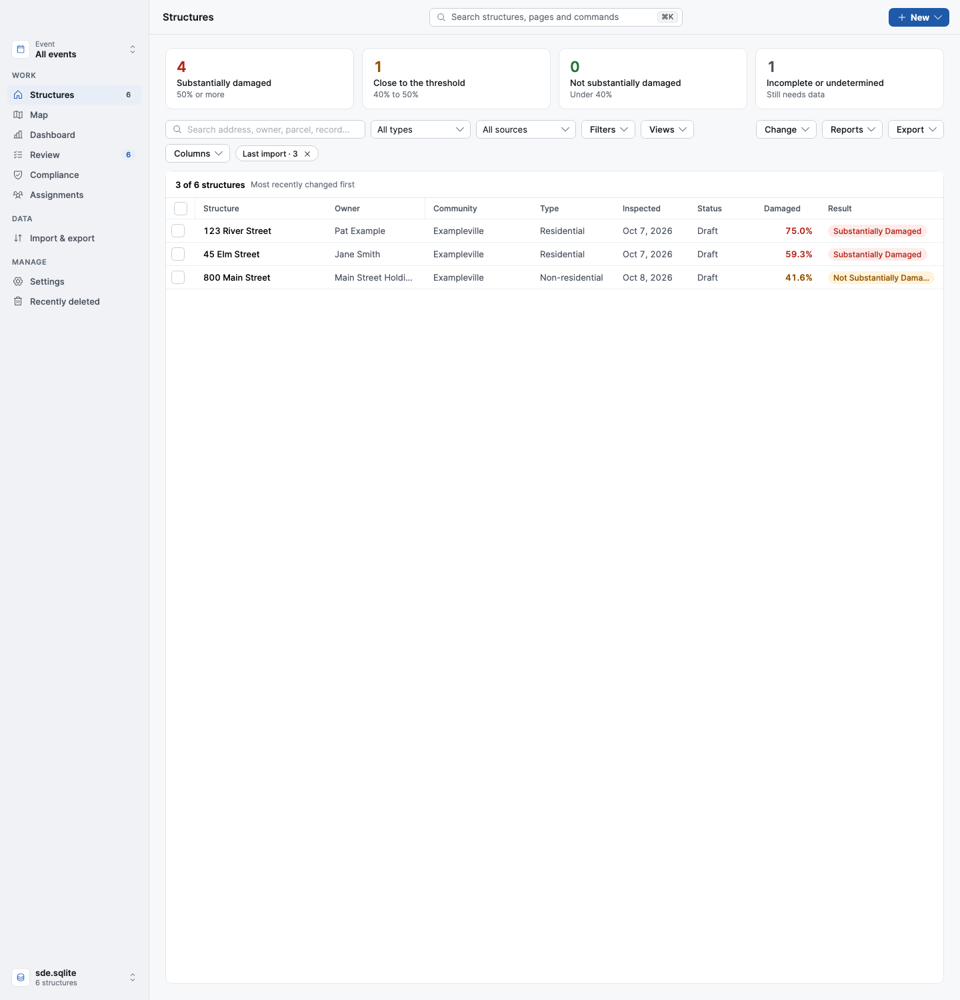

# Importing inspections or parcels → SDE assessments or structures → reports and the FEMA package

SDE for Mac can import records kept in another system: damage inspections from a permit or inspection system, a
spreadsheet the field teams filled in, a parcel list or assessor roll, or the attribute table of a shapefile. Each
record becomes an SDE **assessment** (inspections) or an SDE **structure** (parcels). Afterwards, everything a
community sends after an event can be written into one folder. The flow has three steps:

1. **Import** a file (Import & export → *Inspections or parcels*, or File → Import Inspections or Parcels…, ⌘⇧I).
2. **Review** what came in on the Structures page and finish anything incomplete in the usual editor.
3. **Write a submission folder** (Structures → Export ▾ → *Submission folder*): a PDF report per assessment, the two
   list reports, the FEMA SDE package and `results.csv`.

It works from **files only**: nothing signs in to another system and nothing is written back to it. No system, city
or county is built in. Three example profiles come with the app (see *Examples* below), and one of them is laid out
like an Accela export, because v1.5 started as an Accela import; it is only an example.


## 1. Getting the file out of the other system

Use whatever report, search or export the system already has, and save it as **Excel (.xlsx, .xls), CSV or DBF** (a
shapefile's attribute table). Two layouts work:

- **One row per record** (an inspection, a permit, a parcel), with a column for each value.
- **One row per checklist item**: an export of inspection checklists, with a column naming the item and a column with
  its value. The app combines the rows of each record (and inspection) into one.

Include at least a **record ID** that stays the same from one export to the next (a permit number, an inspection
number, a parcel number). For inspections, also include an **inspection ID** if records can have more than one damage
inspection. Then whatever else the system holds: address, parcel, owner, building details, flood depth and duration,
damage by element, a value or a repair estimate, and so on. Anything the file doesn't have can be typed in once for
all records (below) or filled in later in SDE.

## 2. Importing

Every change re-checks the whole file within a moment, so the preview at the bottom always shows what importing would
do.

1. **The file and its profile.** A *profile* remembers how one source's files map to SDE: what the file is, how
   records are matched, the layout, the columns, fixed values and translations. It is saved when you import, and
   picked again for the next file that has the same record ID column. Profiles are files in
   `~/Library/Application Support/SDE/Import Profiles/`, outside the database, so they carry over to a new database
   for the next event. Use *Show profiles in Finder* to send one to a colleague, *Use a profile someone shared…* to
   add one, and *Start from an example* to begin from one of the examples.
2. **What the file is and how it's laid out.**
   - **Source**: the system or list the file comes from, in your words ("Permits", "County assessor"). It's written
     next to every record ID, so two sources with the same IDs never collide, and Structures shows it ("Permits
     BLD-2026-00123").
   - **Each record becomes** an assessment (*inspections*) or a structure (*parcels, assessor roll*). Importing
     structures uses only the structure's fields (location, building, flood zone); the other field groups are hidden.
   - **New records match** structures already in SDE by record ID only, by parcel number, or by address (see *How
     records are matched*).
   - The layout: one row per record or per checklist item; the record ID and inspection ID columns; for checklists,
     the item and value columns. To leave rows out (for example other inspection types), choose the column under
     *Only rows where* and tick the values to import.
3. **Where each SDE field comes from**, grouped like the editor's eight steps. For each field, pick the column, or type
   a value used for every record: the cause of damage, the base cost per sq ft, the geographic adjustment, the value
   and repair bases… Each mapped field shows an example from the file. Address and owner columns are split the same
   way as in Enterprise Import (whole address, number and name, "John Doe", "Doe, John").
   - *Start new assessments and structures from my default values* uses Settings → Defaults first, with the
     file's values on top.
   - *Copy the record ID into* a custom field puts the record ID into the FEMA package, so the state can see it.
4. **The file's words, SDE's choices.** Any text that isn't one of FEMA's choices or a number is listed with how many
   records use it. Pick what each means (e.g. "Slab on grade" → Slab - on - Grade, "Major" → 75). Until then the field
   is left as it was and the record still imports. Translations are saved in the profile.
5. **What will happen.** Each record, with what it will be, its projected % damaged and determination (for
   inspections), and notes: values that couldn't be used, how many required fields are still empty. Untick any you
   don't want, then **Import**. The import runs with a progress bar; if an assessment it changes is open in the
   editor, the editor is saved first and shows the new values afterwards.

### The building value (assessor values)

FEMA's market value is the value of the **building only, never the land**. Assessor rolls often have a land value, a
building (improvement) value and a total. When a profile uses a column as the building value with the basis *Adj. Tax
Assessed Value*, the page asks **"Is this the value of the building only, without the land?"** and nothing is imported
until you confirm it (*Confirm building value…*). The answer is kept in the profile; mapping a different value column
asks again. A total of land and building would make every percent damaged too low.

### What the import understands

- Numbers as people write them: `$145,000`, `40%`, `1,450`.
- Lengths in feet or inches: `3 ft`, `18 in`, `3' 6"`. Durations with units: `48 hrs`, `2 days` (the units are set too).
- Dates in US or ISO form, with or without a time.
- FEMA's choices ignoring case, spaces and punctuation, and without "(Standard)": `crawl space`, `Stud framed`.
  Condition ratings by number or words: `4`, `4 - Average`, `Average`.
- Number of stories as a number: for homes 1 is *One Story* and 2+ *Two or More Stories*; for other buildings 1,
  2–4 and 5+ pick the three non-residential choices.
- Residential / Non-Residential (also `Res`, `Commercial`), and yes/no (`Y`, `N`, `X`, `True`).

### How records are matched

A record imported before always finds what it was imported into: its assessment (source + record ID + inspection ID)
or its structure (source + record ID). A record not seen before is matched as the profile says:

| New records match | Inspections | Structures |
|---|---|---|
| **By record ID only** | A new structure, except that a parcel number matching exactly **one** structure with no imported assessment adds the inspection to it (as v1.5 did) | Always a new structure |
| **By parcel number** | Added to the one structure with that parcel number | Linked to the one structure with that parcel number |
| **By address** | Added to the one structure at that address | Linked to the one structure at that address |

Parcel numbers are compared without spaces, dashes and dots (`0123-0045.67` = `0123004567`), and optionally without
leading zeros. Addresses are compared by house number and street name, ignoring case and punctuation, with directions
and ordinals written one way (`North` = `N`, `First` = `1st`) and the street suffix compared as FEMA's choice by any of
its abbreviations (`Street` = `St`, `Avenue` = `Ave` = `Av`). Units are ignored unless *The unit must match too* is
ticked; ZIP codes count when both sides have one.

| Status | When |
|---|---|
| **New structure** | Nothing in SDE matches. |
| **Add to existing structure** / **Link to existing structure** | Exactly one structure matches. Its blank fields are filled in; filled-in ones are kept. |
| **New inspection** | Another inspection of a record already in SDE (or earlier in the same file): a new assessment of that structure. |
| **Update** | Imported before, and some values have changed in the source since. The changes are listed. |
| **Final, won't change** | An update to an assessment that is Final (or whose letter was sent). It's left as it is; reopen it to take the changes. |
| **Unchanged** | Imported before, and nothing changed. Nothing is written. |
| **Ambiguous** | Several structures match. Nothing is imported for that record: SDE never guesses. The structures are listed so you can fix or delete the duplicates, or match by something else. |
| **Can't import** | No record ID, the same record (and inspection) twice in the file, or a calculation SDE can't do. |

### Importing an updated file

Each assessment or structure remembers its record and the values last imported. Importing a newer file of the same
records:

- updates **only the fields whose value changed** in the source since the last import;
- **keeps edits made in SDE** to everything else;
- never clears a value because a cell is **blank**;
- never changes a **Final** assessment (the preview and the result say how many);
- changes **nothing** when the file is the same.

Each import is **one batch in edit history** ("Imported from county-parcels.csv"), so you can see everything it did.
If an assessment or structure is deleted in SDE, its link goes with it, and the next import creates it again as new.

### Examples

| Example | What it is | Each record becomes | Matches by |
|---|---|---|---|
| **Generic inspections** | A spreadsheet of inspections with a building value and a repair estimate | An assessment | Address |
| **County parcels** | An assessor roll: parcel ID, site address, owner, class, year built, living area | A structure | Parcel number |
| **Accela (example)** | An inspection report from one permit system, one row per inspection | An assessment | Record ID (v1.5's rule) |

They match the synthetic files in `tests/fixtures/import/`. Start from the closest one, check each column against your
file, and import: the profile is saved under its name (rename it under *Save as*).

## 3. Reviewing

After importing, **Review the N in Structures →** opens the Structures list showing just that import, with a
*Last import · N ×* chip (click × to see everything again).

- Each imported row shows its source and record under the address ("Pat Example · Permits BLD-2026-00123"), and the
  search box finds record IDs.
- *All sources / Imported / Entered in SDE* filters by where structures came from.
- Open an assessment as usual; its subtitle ends with the source, record and inspection. Missing required fields are
  listed in the editor, as for any assessment.



## 4. The submission folder

Structures → **Export ▾ → Submission folder (reports + FEMA package)…** works on the checked structures, or on the
whole current list when none are checked (so the import chip or a filter narrows it). Choose the report for each
assessment (one-page Summary or Detailed), with or without photos, and whether to include incomplete assessments, then
a folder. A progress bar shows each report; *Stop* removes the half-written folder.

```
SDE submission 2026-10-08 1430/
  Reports/
    BLD-2026-00123 – 123 River Street.pdf      one per assessment, named after its record ID
    45 Elm Street.pdf                          (just the address when it wasn't imported)
  Percent damaged list.pdf
  Community report.pdf
  SDE_1/                                       the FEMA SDE package: Export.json + photos
  results.csv                                  one row per assessment
```

- Assessments still at **Data Entry Incomplete** are left out unless included; the panel says how many.
- When a structure has several inspections in the folder, the inspection date is added to the report names.
- **`SDE_1`** is the same format as any SDE export, for FEMA or the state. Import links are not in it.
- **`results.csv`** has the source, record and inspection ID, address, parcel, owner, inspection date and inspector,
  the value and repair bases and amounts, % damaged, determination and the report's file name: everything needed to
  enter the determinations back into the system the inspections came from. Amounts are plain numbers; it opens
  directly in Excel or Numbers.


## For developers

| Piece | Where |
|---|---|
| Link tables (Mac-only, never exported) | `ExternalLink` (assessment ↔ record) and `StructureLink` (structure ↔ record) in `src/Sde.Data/Schema.sql`; `SdeStore.SaveImport`, `GetExternalLink(s)` in `SdeStore.Import.cs`; `SaveStructureImport`, `GetStructureLink(s)`, `GetStructureLinksFor` in `SdeStore.Links.cs` |
| Field catalog, header guessing | `src/Sde.Interop/SourceImport/SourceFields.cs` |
| Profile (JSON) and the examples | `SourceProfile.cs`, `ShippedProfiles.cs` + `Profiles/*.json` (embedded); app storage `src/Sde.App/Services/ImportProfiles.cs` |
| Reading, filter, checklist pivot | `SourceTable` (`src/Sde.Interop/SourceTable.cs` + `SourceImport/SourceTable.Shape.cs`); `.xls` and `.dbf` via `Internal/SheetReader.cs`, `Internal/DbfReader.cs` |
| Source text → SDE values | `SourceValues.cs` |
| Matching | `AddressMatcher.cs` (`AddressMatcher`, `AddressIndex<T>`, `ParcelNumbers`) |
| Preview, matching, import | `SourceImport.cs`, `SourceRowBuilder.cs`; address/owner parsing shared with Enterprise Import (`Internal/PropertyRowParser.cs`) |
| Submission folder | `src/Sde.Reports/SubmissionFolder.cs`, `Internal/ResultsCsv.cs` |
| App | `SourceImportViewModel` / `SourceImportView` (`Page.SourceImport`), `SubmissionViewModel`, Structures chip and source filter |
| Tests | `ExternalLinkTests`, `SourceTableTests`, `SourceImportTests`, `SourceImportModesTests`, `SourceMatchingTests`, `SubmissionFolderTests`, `SourceImportUiTests`, `SubmissionUiTests` |

All the types live in the `Sde.Interop` namespace (a namespace called `SourceImport` would clash with the
`SourceImport` class).

**Compatibility.** Profiles saved by v1.5 (`Accela Profiles/`) are copied once into `Import Profiles/`; the old folder
is left for v1.5. A v1.5 profile has no `SourceName`, so it reads as an Inspections profile from "Accela", matching by
record ID: its existing links (`ExternalLink.Source = 'Accela'`) keep matching, and nothing in the database needs to
change. The app setting `LastAccelaProfile` is read as `LastImportProfile`. Both link tables are added to older
databases when they're opened (`SdeDatabase.EnsureSchema`) and use `ON DELETE CASCADE`, so older versions can still
delete. Export.json is byte-for-byte the same with or without links.

**Each re-import compares resolved values**, not raw text: the canonical form after translation (a FEMA choice's
name, an invariant number, an ISO date). They're stored as JSON in `SourceValues` of the link, so `$1,450` and `1450`
count as the same value, and changing a translation counts as a change.

**Saves go through the tracked saves.** Inspections use `SdeStore.SaveImport`, structures `SaveStructureImport`
(each structure through the same tracked save as `SaveProperties`), both with `SaveContext.Batch(SaveVia.Import,
"Imported from <file>")`: one transaction and one history batch per import. `SaveImport` skips Final and Letter sent
assessments and returns their IDs; `SourceImportResult.LockedIds` reports them with those seen in the preview.

**Enterprise Import** (FEMA's own feature) reads files with the same `SheetReader`, parses rows with the same
`PropertyRowParser`, and, given the structures in the database, warns about rows that look like one already there
(same parcel or address) using the same matcher. It still creates every row as a new structure, as FEMA's does.

**Still to do with real files:** tune the header guesses (`SourceFields.Synonyms`) and the examples against real
(anonymised) exports. Records covering several buildings aren't handled.
