# SDE for Mac: user guide

This guide walks through every task in SDE for Mac, roughly in the order an office meets them during an event. To
install the app, follow [Install in the README](../README.md#install) first.

**How to read the steps.** Words in **bold** are what you see on screen. "**File > New Database…**" means open the
File menu and choose New Database. ⌘ is the Command key, ⇧ is Shift and ⌥ is Option. Buttons ending in ▾ open a menu.

> SDE for Mac is not produced or endorsed by FEMA. It applies FEMA's method, but every determination remains the
> responsibility of the local floodplain administrator.

## Contents
1. [How SDE is organised](#1-how-sde-is-organised)
2. [Setting up for an event](#2-setting-up-for-an-event)
3. [Adding structures](#3-adding-structures)
4. [Assessing a structure, step by step](#4-assessing-a-structure-step-by-step)
5. [Photos](#5-photos)
6. [Reviewing, locking and undoing](#6-reviewing-locking-and-undoing)
7. [Working with many structures](#7-working-with-many-structures)
8. [Looking up locations and flood data online](#8-looking-up-locations-and-flood-data-online)
9. [The map and the event dashboard](#9-the-map-and-the-event-dashboard)
10. [Reports and sending results to FEMA or your state](#10-reports-and-sending-results-to-fema-or-your-state)
11. [Owner letters](#11-owner-letters)
12. [Substantial improvement](#12-substantial-improvement)
13. [Appeals and contractor bids](#13-appeals-and-contractor-bids)
14. [Cumulative damage](#14-cumulative-damage)
15. [The phone form](#15-the-phone-form)
16. [Backups, moving and sharing](#16-backups-moving-and-sharing)
17. [Troubleshooting](#17-troubleshooting)
18. [Keyboard shortcuts](#18-keyboard-shortcuts)

---

## 1. How SDE is organised

### The words SDE uses
| Word | What it means |
|---|---|
| **Structure** | One building: its address, owner, building details and flood zone. |
| **Assessment** | One damage inspection of a structure: what was damaged, how much, and the result. A structure can have more than one (a second inspection, or damage from a later event). |
| **Percent damaged** | The cost of repairs divided by the value of the building before the damage. |
| **Result** (determination) | FEMA's finding for an assessment, such as *Substantially Damaged* (50 percent or more) or *Not Substantially Damaged*. |
| **Database** | One file holding structures, assessments and photos. Many offices keep one database per event. |
| **Event** | A disaster (a flood, a storm) with its name, dates and FEMA disaster number. A database can hold several; each assessment belongs to one at most. |

### The window
The sidebar on the left switches between pages:

| Page | What it's for | Shortcut |
|---|---|---|
| **Structures** | The list of every structure with its latest result. This is home. | ⌘1 |
| **Map** | Every structure on a map, coloured by result. | ⌘2 |
| **Dashboard** | Totals for the event, and files to share. | ⌘3 |
| **Review** | Assessments waiting for review, and the checks that flag problems. | ⌘4 |
| **Compliance** | Follow-up on substantially damaged structures: permits, deadlines, ICC claims. | ⌘5 |
| **Assignments** | Teams and the structures assigned to them. | ⌘6 |
| **Import & export** | Exchanging data with FEMA's SDE, spreadsheets, photos and GIS. | ⌘7 |
| **Settings** | Your name, default values, letters, the phone form, backups and other options. | ⌘8 |
| **Recently deleted** | What you deleted in the last 30 days. | ⌘9 |

The bar across the top shows where you are (for example **Structures › 123 River Street**; click **Structures** to go
back), a search field that finds structures, pages and commands (⌘K), and **New**. The top of the sidebar chooses the
event, and the bottom shows which database is open and how many structures it holds.

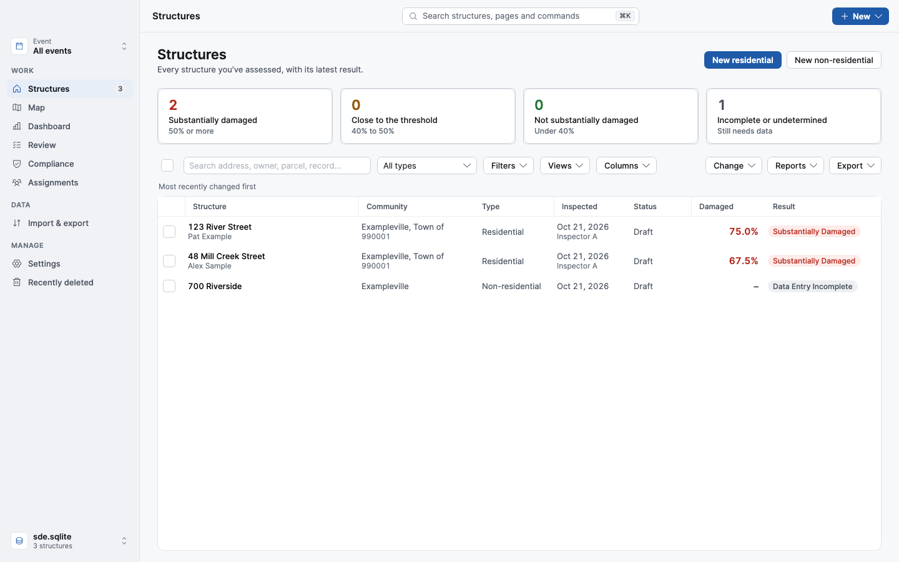

### Saving
Everything saves itself as you type. There is no Save button to forget. **File > Save** (⌘S) saves immediately if
you want to be sure before closing the lid.

### Where your data is kept
- The database is a single file. Until you make your own, SDE uses `~/Library/Application Support/SDE/sde.sqlite`.
- Photos are kept in an `attachments` folder next to the database file.
- Automatic backups are kept in a `Backups` folder next to the database file.

**Settings > Backups** shows the database file and the photos folder, with **Show in Finder**.

---

## 2. Setting up for an event
Do this once at the start of each event. It takes about ten minutes and saves a lot of typing later.

### 2.1 Make a database for the event
1. Choose **File > New Database…** (or **Settings > Backups > New empty database…**).
2. In the save panel, make a new folder named for the event (for example `2026-09 River flood`) and save the database
   inside it. Its photos and backups will go into the same folder, so the whole event stays together.
3. SDE switches to the new, empty database. To go back to another one, use **File > Open Recent** or **File > Open
   Database…** (⌘O).

### 2.2 Tell SDE who you are
1. Open **Settings** (⌘8). It opens at **General**.
2. Check **Your name**. It starts as your Mac account's name and is shown in each assessment's
   history next to the changes you make.

### 2.3 Fill in default values
Default values are filled into every new structure and assessment, so you type what is the same for every building
in this event only once (FEMA calls this *Enter Default Data*).

1. In **Settings > Defaults**, fill in what is the same for most buildings: for example the community, the
   FIRM panel information, the cause and date of the damage, and the cost data. They save as you type.
2. Turn on **Fill new structures with my default values** at the top of the same page.

### 2.4 Optional preferences
These are in **Settings > General**.

- **Check that latitude and longitude are inside the structure's state**: FEMA's *Lat/Long Validation*. Turn it on to
  catch coordinates typed with a wrong sign or swapped.
- **Your fields**: three extra fields on every assessment. Name them for what your office tracks, such as *Permit
  number* or *Inspection team*.
- **Note snippets**: text you type often (for example a standard note about water lines). Click **Add a snippet**,
  give it a name and the text. In an assessment, **Insert snippet** above any notes box adds it.

### 2.5 Things to set up only if you need them
| If you will… | Set it up in | Guide |
|---|---|---|
| Send letters to owners | Settings > Reports & letters | [Chapter 11](#11-owner-letters) |
| Track substantial improvement permits | Settings > Reports & letters | [Chapter 12](#12-substantial-improvement) |
| Count damage from several events together | Settings > Reports & letters | [Chapter 14](#14-cumulative-damage) |
| Use your community's depth-damage table | Settings > Depth tables | [Step 6 in chapter 4](#step-6-damage-by-element) |
| Let inspectors use phones | Settings > Phone form | [Chapter 15](#15-the-phone-form) |

**Sharing the setup with colleagues:** see [Share your setup](#share-your-setup) in chapter 16.

### 2.6 Events
When one database holds more than one disaster, give each an event, so you can see one at a time.

1. Click the event switcher at the top of the sidebar and choose **New event…**. Give it a name, the kind, FEMA's
   disaster number if there is one, and its dates. The **datum offset** is only needed when high-water marks use a
   different vertical datum from the structures' elevations: it is added to the marks.
2. SDE chooses the new event. While it is chosen, **Structures**, the **Map**, the **Dashboard** and the reports,
   letters and exports you make from them cover only its assessments, and a new assessment you start joins it.
3. To put existing assessments in it, choose **All events**, tick them on the Structures list, then **Change > Set
   event…**. In the editor, **⋯ > Set event…** does the same for one assessment.
4. When an assessment's damage date falls between an event's dates and it is in no event, the editor offers to add it.

**Manage events…** in the switcher renames or deletes events. Deleting an event keeps its assessments; they just
belong to no event. SDE remembers the chosen event for each database. Cumulative damage still counts every event
together (chapter 14).

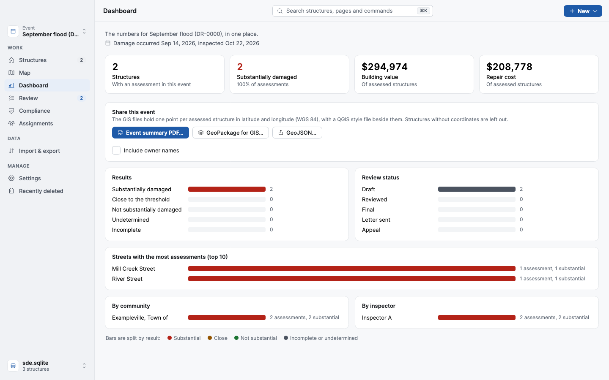

---

## 3. Adding structures
There are four ways to get structures into SDE. Use whichever matches where the information is now.

| The information is… | Use |
|---|---|
| Nowhere yet; you'll enter it as you inspect | [3.1 By hand](#31-by-hand) |
| In FEMA's SDE on Windows, or another copy of SDE for Mac | [3.2 From FEMA's SDE](#32-from-femas-sde-or-another-sde-for-mac) |
| In a permit or inspection system, a spreadsheet, or an assessor roll | [3.3 Inspections or parcels](#33-from-a-permit-system-spreadsheet-or-assessor-roll) |
| In a simple parcel spreadsheet, once | [3.4 Enterprise Import](#34-enterprise-import-femas-parcel-spreadsheet-import) |

### 3.1 By hand
1. On **Structures**, click **New residential** (⌘N) or **New non-residential** (⇧⌘N).
2. The editor opens on the first step. Go on to [chapter 4](#4-assessing-a-structure-step-by-step).

Nothing is saved until you type something, so opening a new structure and closing it straight away leaves nothing
behind.

### 3.2 From FEMA's SDE or another SDE for Mac
SDE reads three kinds of FEMA data: an **SDE export folder** (Export.json and photos, made by *Export SDE data* in
FEMA's SDE 3.0 or by SDE for Mac), a folder from the older **SDE 2.x**, and FEMA SDE 3.0's own database file,
**SDEDatabase.mdb**.

1. Get the data from the other computer: an export folder, or a copy of `SDEDatabase.mdb` together with the
   `attachments` folder beside it (that's where its photos are).
2. Choose **File > Import SDE Data…** (⌘I). Or open **Import & export** and, under **FEMA SDE data > Import**, click
   **SDE export folder…** or **SDE database (.mdb)…**. You can also drag the folder or `.mdb` file onto the Import &
   export page.
3. Under **Ready to import**, SDE lists what it found before anything is added. Untick anything you don't want.
4. Choose what happens **If a structure is already in your database**:
   - **Keep mine (skip it)**,
   - **Replace mine with the imported one**, or
   - **Keep both (import a copy)**.
5. Click **Import checked**.

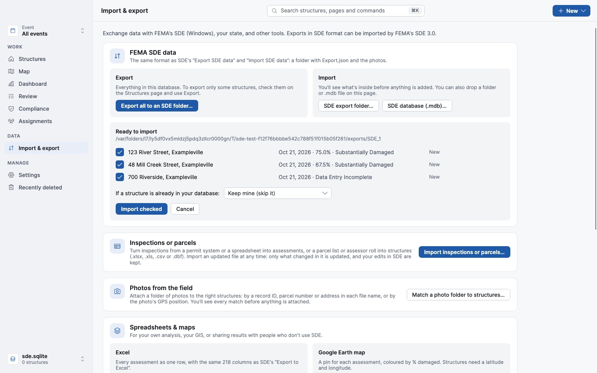

### 3.3 From a permit system, spreadsheet or assessor roll
This turns **inspections** into assessments, or a **parcel list or assessor roll** into structures. You can import an
updated file at any time: only what changed in it is updated, and edits you made in SDE are kept. The full details are
in [Importing inspections or parcels](IMPORTING.md); the steps are:

1. **Export from the other system.** Save its report or search results as `.xlsx`, `.xls`, `.csv` or a shapefile's
   `.dbf`. Include a **record ID** that never changes (a permit, inspection or parcel number).
2. Choose **File > Import Inspections or Parcels…** (⇧⌘I), or **Import & export > Inspections or parcels > Import
   inspections or parcels…**, and choose the file.
3. **Pick a profile.** A profile remembers how one source's files map to SDE. The first time, click **Start from an
   example** and pick the closest: **Generic inspections**, **County parcels** or **Accela (example)**. Next time, SDE
   picks your saved profile automatically.
4. **Say what the file is.**
   - **Source**: the system's name in your words, such as *Permits* or *County assessor*.
   - **Each record becomes** an assessment (inspections) or a structure (parcels).
   - **New records match** existing structures by record ID only, by parcel number, or by address.
5. **Map the columns.** For each SDE field, pick the column it comes from, or type one value for every record (for
   example the cause of damage). Each mapped field shows an example from the file.
6. **Translate the file's words.** Text that isn't one of FEMA's choices is listed with how many records use it. Pick
   what each means, for example *Slab on grade* is **Slab - on - Grade**.
7. **Confirm the building value** if SDE asks. FEMA's market value is the building only, never the land. If the column
   is a total of land and building, every percent damaged would come out too low.
8. **Check the preview** at the bottom: each record shows whether it is new, an update, unchanged, ambiguous or can't
   be imported, with its projected result. Untick any you don't want, then click **Import**.
9. Click **Review the N in Structures →** to see just what came in. The **Last import** chip above the list shows the
   filter; click its × to see everything again.

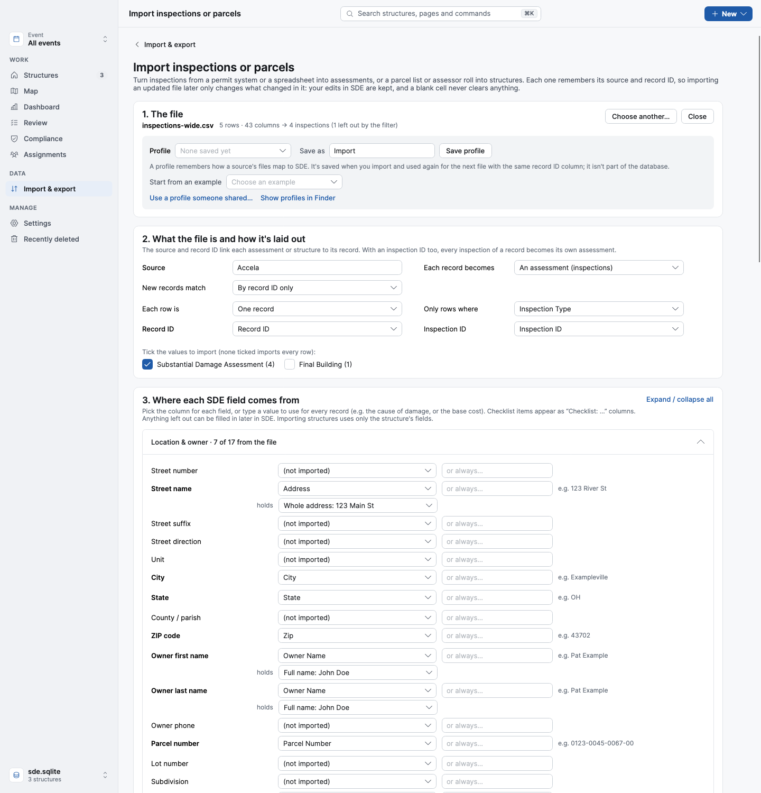

### 3.4 Enterprise Import (FEMA's parcel spreadsheet import)
FEMA's SDE has a simpler import that makes one structure per row of a parcel or GIS spreadsheet. SDE for Mac keeps it
for compatibility; for anything you will import again, use [3.3](#33-from-a-permit-system-spreadsheet-or-assessor-roll)
instead.

1. Open **Import & export** and find **Create structures from a parcel spreadsheet**.
2. Click **Choose spreadsheet…** and pick a `.xlsx` or `.csv` file. Choose the **Sheet** and whether the **First row
   has the column names**.
3. Match columns to fields, or pick a **Saved mapping**.
4. Import. SDE warns about rows that look like a structure already in the database (same parcel or address).

### 3.5 Adding coordinates
Structures need a latitude and longitude to appear on the map and in GIS files. Any of these work:

- [Look them up online](#8-looking-up-locations-and-flood-data-online) from the address.
- [Click each one on the map](#the-map) with **Set location**.
- Use a photo's GPS position ([chapter 5](#5-photos)).
- Add them in bulk with a spreadsheet:
  1. **Import & export > Add coordinates in bulk > Save coordinates spreadsheet…**
  2. Fill in the **Latitude** and **Longitude** columns, by hand or with a geocoder.
  3. Click **Read coordinates…**. SDE shows each structure's coordinates **NOW** and **FROM SPREADSHEET**.
  4. Untick anything wrong and click **Save checked coordinates**.

---

## 4. Assessing a structure, step by step

### Opening the editor
On **Structures**, double-click a row, or select it and press Return. The editor has three columns:

- **The steps** on the left, each marked **Complete**, **N to check** or **Optional**.
- **The fields** of the current step in the middle.
- **The result** on the right: the percent damaged and FEMA's result, the values behind them, and **Needs attention**,
  which lists what is still missing.

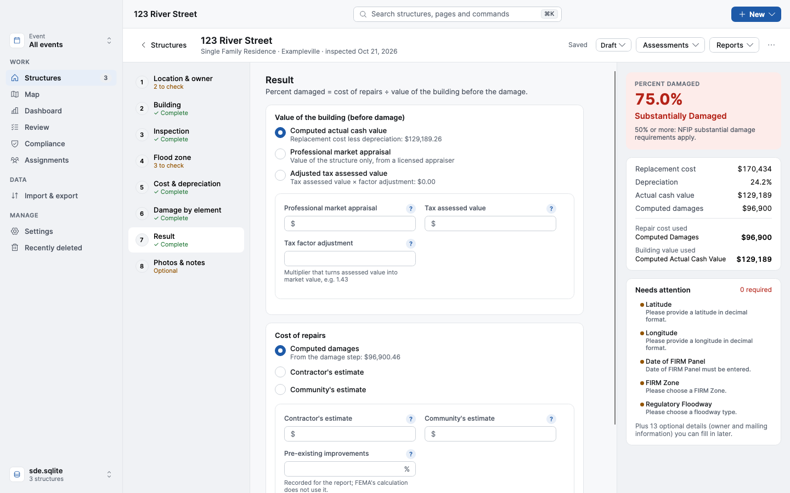

Move between steps by clicking them, or with ⌘[ and ⌘]. Click **‹ Structures** to go back to the list. The **?**
next to a field explains what to enter and which page of FEMA's SDE User Manual covers it.

When you change something that makes other fields irrelevant, SDE clears them, as FEMA's SDE does. For example,
changing the cause of damage away from flood clears the flood details.

### Step 1: Location & owner
The address, parcel number, owner, owner's phone numbers, the mailing address if it differs, and the latitude and
longitude. **Look up online…** fills in the coordinates from the address ([chapter 8](#8-looking-up-locations-and-flood-data-online)).

### Step 2: Building
- **Structure type** and **Number of stories**.
- For homes: **Residence type**, **Foundation**, **Superstructure**, **Roof covering**, **Exterior finish** and
  **Heating & cooling**.
- For other buildings: **Structure use**, **Sprinkler system** and **Conveyance (elevators)**.
- **Year built**, **Construction quality** and **Notes about the structure**.

### Step 3: Inspection
- **Inspector**, **Inspector phone** and **Inspection date**.
- **Date damage occurred** and **Cause of damage** (with **Describe the cause** for *Other*).
- For floods: **Flood duration** with its units, **Flood elevation** and **Depth above lowest floor**.
- **Damage undetermined**, with the **Reason damage is undetermined**, when the building couldn't be assessed.

### Step 4: Flood zone
**NFIP community ID**, **Community name**, **FIRM panel number**, **Panel suffix**, **FIRM panel date**, **FIRM zone**,
**Base flood elevation (BFE)**, **Regulatory floodway**, **Elevation of lowest floor** and **Datum**. **Look up
online…** proposes values from FEMA's National Flood Hazard Layer for you to confirm.

### Step 5: Cost & depreciation
1. **Square footage.** Add the building's footprint as shapes (**+ Rectangle**, **+ L-shape**, **+ T-shape**,
   **+ U-shape**) with lengths, widths and stories, or **+ Type a total**.
2. **Base cost per sq ft**, **Geographic adjustment**, **Cost data source** and **Cost data date**.
3. **Cost adjustments**: features that add to the replacement cost. The list depends on the type of building.
4. **Additional adjustments**: anything else that belongs in the replacement cost, up to seven lines.
5. **Condition rating**, which sets the **Depreciation**. If you choose *Other*, say why.

The step shows the arithmetic: base cost × square footage × geographic adjustment, plus adjustments, gives the
**Replacement cost**; minus depreciation gives the **Actual cash value (pre-damage)**.

### Step 6: Damage by element
For each part of the building, estimate how much of it is damaged: 0 percent means untouched, 100 percent means it
must be fully replaced. FEMA's tables set how much of the replacement cost each part represents (**SHARE**), so the
step shows each element's cost and damage, and the total.

- On a slider, the keys **0** to **4** set 0, 25, 50, 75 and 100 percent.
- **Using a depth table** (if your community made one in **Settings > Depth tables**):
  1. Choose it under **Depth table to use**.
  2. Click **Suggest from depth table**. SDE fills in the values your table gives for the depth above the lowest floor,
     each marked **Suggested**.
  3. Look at each one, then click **Accept**, change it, or click **Accept all**.

  An assessment can't be made Final while any suggestion is still unaccepted, because a suggestion is not an
  inspector's judgment.

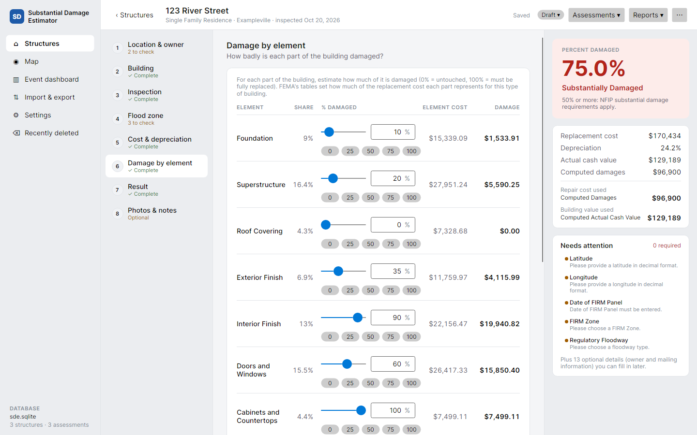

### Step 7: Result
Choose the two numbers the percent damaged is based on:

- **Value of the building (before damage)**: **Computed actual cash value** (from step 5), a **Professional market
  appraisal** (the structure only, from a licensed appraiser), or the **Adjusted tax assessed value** (the tax assessed
  value × the **Tax factor adjustment**, which turns assessed value into market value).
- **Cost of repairs**: **Computed damages** (from step 6), a **Contractor's estimate**, or the **Community's estimate**.

**Pre-existing improvements** is recorded for the report; FEMA's calculation doesn't use it.

### Step 8: Photos & notes
Photos ([chapter 5](#5-photos)), notes (with **Insert snippet**), and **Your fields**.

### When is an assessment finished?
Look at **Needs attention** in the result panel. It lists required fields first; when it says **0 required**,
everything FEMA's SDE requires has been entered. Optional details (such as the owner's mailing address) can be added later.

### More than one assessment of a structure
In the editor, **Assessments ▾** lists every assessment of the structure. **+ New assessment of this structure**
starts another one, for example for a re-inspection or a later event.

### Copying from a similar building
For rows of similar buildings, open the new assessment and choose **⋯ > Copy from another structure…**. Pick the
structure and tick the steps to copy. The location, owner and damage are never copied.

---

## 5. Photos

### Adding photos
1. Open the assessment and go to **Photos & notes**.
2. Drag photos onto **Drag photos here**, or click **Choose photos…**. JPEG, PNG and HEIC (the iPhone's format) all
   work; HEIC photos are converted to JPEG.
3. If a photo has a GPS position or a date, SDE offers **Use as the structure's location** and **Use as the inspection
   date**. Click **Not now** to skip.

### Order, report photo and descriptions
- Reports show the photos in their order, with the starred **Report photo** first. Drag a photo by its handle, or use
  the arrows, to change the order. **Use on reports** stars a photo.
- Type a **Description** under each photo; it appears on the reports.
- **Remove** moves a photo to Recently deleted, so it can be restored for 30 days.

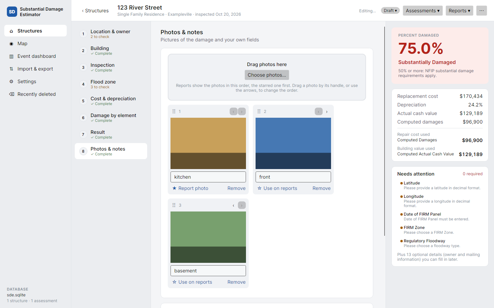

### Matching a whole folder of photos to structures
When field teams bring back a folder of photos:

1. Open **Import & export > Photos from the field** and click **Match a photo folder to structures…**.
2. Choose the folder. SDE matches each photo by a record ID, parcel number or address in its file name, or otherwise
   by its GPS position (within 40 metres).
3. Check the list (**PHOTO**, **STRUCTURE**, **WHY**, **DISTANCE**). Photos that match no structure, or two structures
   equally, are left out.
4. Click **Attach ticked photos**.

---

## 6. Reviewing, locking and undoing

### Statuses
Every assessment has a review status, set with the status button at the top of the editor (it shows the current one,
such as **Draft ▾**):

| Status | Meaning |
|---|---|
| **Draft** | Being entered. Every new assessment starts here. |
| **Reviewed** | Someone has checked it. |
| **Final (locks it)** | The determination is made. Nothing can change it. |
| **Letter sent (locks it)** | The owner has been told. Set by **Mark as sent** after writing letters. |
| **Appeal** | The owner has appealed and it is being reconsidered. |

The Structures list has a **Status** column and a status filter, so you can list everything not yet Final.

### Locks
A **Final** or **Letter sent** assessment can't be changed: not in the editor, not by bulk changes, not by imports and
not from the phone form. To change one, choose another status. SDE asks for a reason, which is kept in the history.

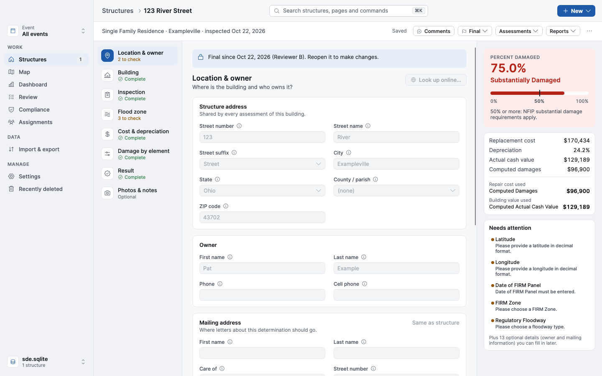

### History
**⋯ > History…** in the editor shows who changed what and when, including bulk changes, imports and changes made from
a phone. A change can be reversed from the history with **Undo this change**.

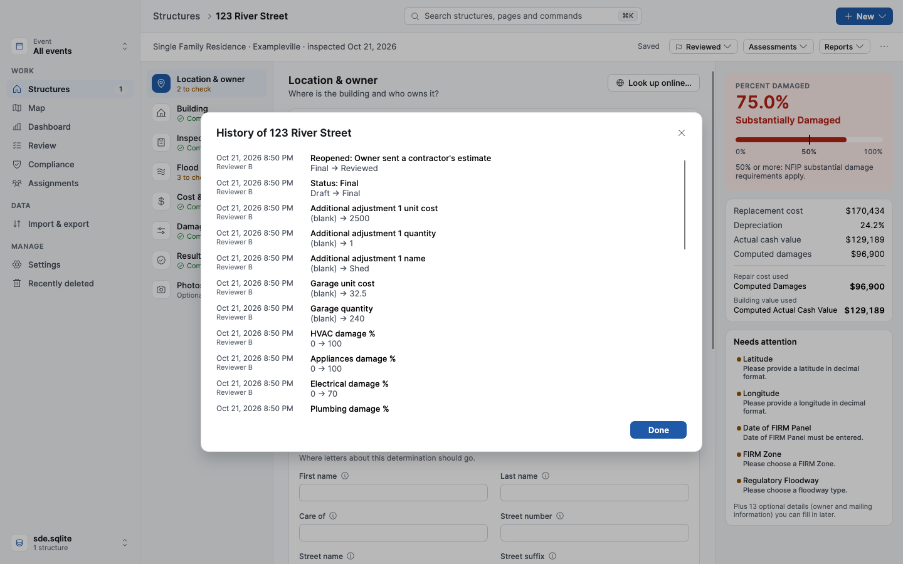

### Undo and redo
In the editor, **Edit > Undo** (⌘Z) and **Edit > Redo** (⇧⌘Z) step back and forward through your changes.

### Recently deleted
- To delete a structure or assessment, use **⋯ > Move to Recently Deleted** in the editor, or right-click its row on
  Structures.
- Deleted items stay in **Recently deleted** for 30 days. Select one and click **Restore** to bring it back, or
  **Delete now…** to remove it for good. **Empty Recently deleted…** removes everything there.

---

## 7. Working with many structures

### Finding structures
- **Search** (⌘F): type part of an address, owner, parcel number or record ID.
- **All types**: residential, non-residential or both.
- **All sources / Imported / Entered in SDE**: shown once anything has been imported.
- **More filters**: **Inspected from** and **to**, **Damaged at least** and **at most** (percent), **Street**, **ZIP
  code**, **Parcel number** and **Status**. **Clear these filters** removes them. Filters are remembered.

### Sorting, columns and saved views
- Click a column heading to sort by it. **The order you see is the order reports print in.**
- **Columns ▾** shows or hides columns such as ZIP, parcel, FIRM zone, source record and last changed.
- **Views ▾ > Save this view…** saves the current search, filters, sort and columns under a name, for example
  *Not yet Final on Main Street*. Pick it from **Views ▾** later.

### Checking structures
Tick the box at the start of each row, or the box in the heading to check every structure shown. **Reports ▾,
Export ▾ and Change ▾ work on the checked structures, or on every structure shown when none is checked.**

### Setting one field on many structures
1. Check the structures (or filter the list to them).
2. Choose **Change ▾ > Set a field on these…** (or **Edit > Set a Field on Checked Structures…**).
3. Pick the field and the value, check the preview and apply.

Final assessments are skipped. The whole change is one entry in each assessment's history, so it can be undone there.

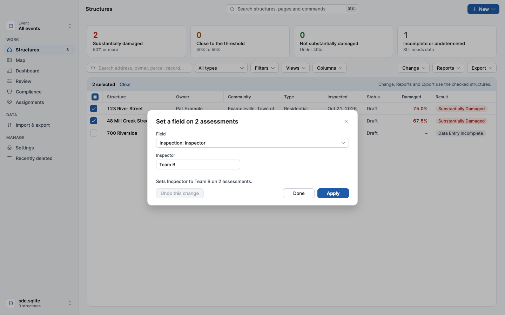

### Search and replace
**Change ▾ > Search and replace…** (or **Edit > Search and Replace…**) replaces text in the same fields FEMA's SDE
allows, with a preview before anything changes.

### Right-clicking a row
**Open**, **Copy from another structure…**, **Set a field on the checked structures…** and **Move to Recently
Deleted**.

---

## 8. Looking up locations and flood data online
SDE can propose:

- **coordinates** from the address, using the U.S. Census Bureau's geocoder, and
- **flood data** from FEMA's National Flood Hazard Layer (NFHL): the flood zone, floodway, base flood elevation, FIRM
  panel, suffix and effective date, and the community ID.

This needs an internet connection. The address is sent to the Census Bureau and the coordinates to FEMA; nothing else
leaves your Mac. Nothing changes until you confirm it.

### For one structure
1. Open the assessment and go to **Location & owner** or **Flood zone**.
2. Click **Look up online…**.
3. SDE shows each **FIELD** with its value **NOW**, the value **FOUND ONLINE**, and where it came **FROM**.
4. Tick the values you want and click **Apply ticked values**. The history notes where they came from.

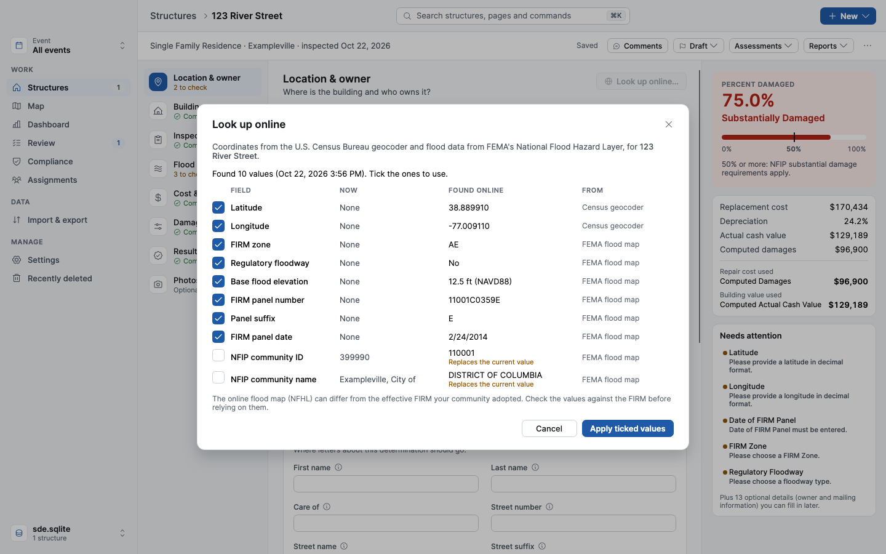

### For many structures
1. On Structures, check the structures (or filter the list).
2. Choose **Change ▾ > Look up flood data online…**. SDE looks them up a few at a time.
3. Review the results and apply the ones you want.

**Check before you rely on it.** The NFHL is FEMA's online flood map. It can differ from the effective FIRM your
community has adopted (for example while a map revision is pending), so confirm against the effective FIRM.

---

## 9. The map and the event dashboard

### The map
**Map** (⌘4) shows every structure that has coordinates, coloured by its result, over a background map and any layers
you add.

What a click does depends on the mode above the map:
- **Open**: click a dot to open that structure's assessment, or click a layer's shape to see its values. Hold ⌘ and
  drag to select structures.
- **Select**: click a dot or drag a box to select structures (hold ⌘ to add to the selection). **Select in** picks a
  layer to select its shapes instead. **Draw an area** selects what is inside the corners you click (double-click or
  press Return to finish). **By attribute…** selects by the values of fields, for example *flood_zone = AE* and
  *land_value > 30000*.
- **Set location**: pick the structure under **Structure to place**, then click where it is on the map.
- **Measure**: click points to measure a distance, or choose **Area** for an area and its perimeter. Double-click or
  press Return to finish. Distances are measured along the earth's surface, areas on an equal-area projection.

Selected structures are the ones checked in the Structures list. The bar on the map acts on them: **Show in
Structures**, **Set a field…**, **Assign to team…**, **Reports** and **Add to web map…**.

When the map has focus, the arrow keys move it and = and - zoom. **Bookmarks** saves the view and goes back to it.
**Show all** zooms to every structure. The basemap menu next to **Bookmarks** picks the background map: USGS
topographic map, USGS aerial imagery, OpenStreetMap or none.

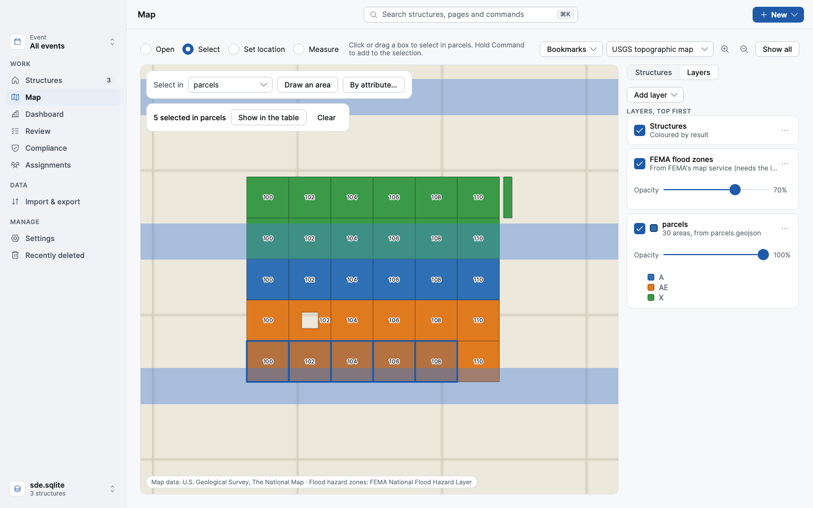

#### Layers
Click **Layers** beside the map:
- **Add layer > From a file…** reads a Shapefile, GeoJSON, GeoPackage, or CSV with latitude and longitude (or WKT).
  SDE copies the shapes into a GeoPackage next to the database (`sde.sqlite.layers.gpkg`), which QGIS and ArcGIS
  open too.
- **Add layer > From an ArcGIS web address…** downloads a FeatureServer or MapServer layer for the area in view.
- **Add layer > FEMA flood zones** draws FEMA's National Flood Hazard Layer over the map.
- Each layer's **⋯** menu has **Style…** (one colour, by category or by number range, labels, and the scales it shows
  at), **Attribute table**, **Zoom to layer**, **Move up**, **Move down** and **Remove…**. **Opacity** fades it.
- **Style…** under **Structures** colours the dots by result (the default), status, team, event or any field.

The attribute table under the map sorts by a column, filters by text and can show only the selected shapes. Picking
rows selects them on the map.

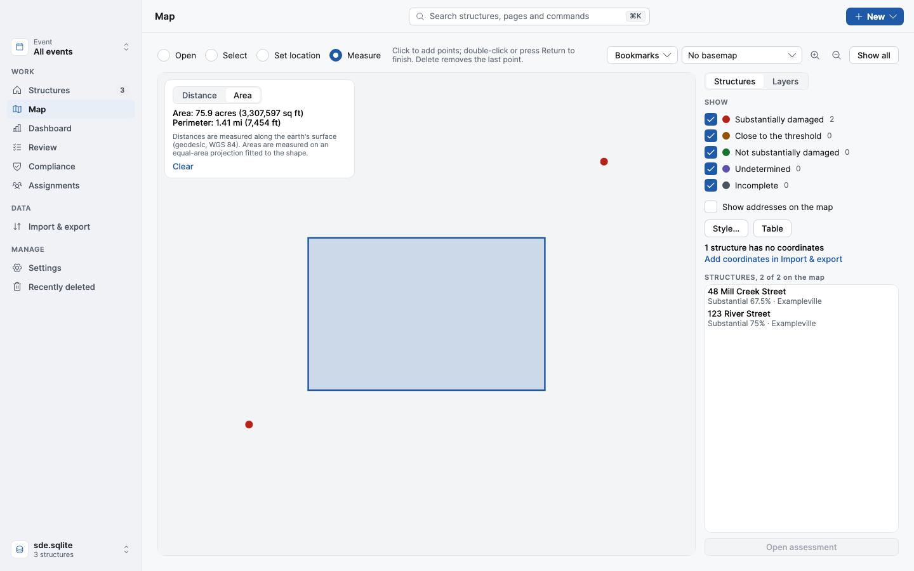

The background map, the flood zones and ArcGIS layers need an internet connection. The dots and layers from files work
offline.

### The event dashboard
**Event dashboard** shows the numbers for the whole database: how many structures, how many substantially damaged,
the total building value and repair cost, and bars by result, by street (top ten), by community and by inspector.

Under **Share this event**:
- **Event summary PDF…**: the same numbers as a report (type an **Event name** to show on it).
- **GeoPackage for GIS…** and **GeoJSON…**: one point per assessed structure, in latitude and longitude (WGS 84), with
  a QGIS style beside it. Owner names are left out unless you tick **Include owner names**.

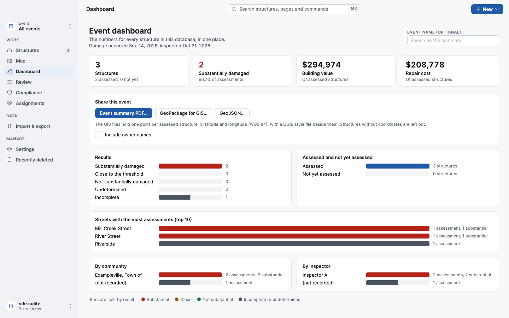

---

## 10. Reports and sending results to FEMA or your state

### Reports for one assessment
In the editor, **Reports ▾** prints a **Summary report** (one page) or a **Detailed report**, each with or without
photos, as a PDF.

### Reports for many
On Structures, **Reports ▾** prints the same reports for the checked structures (or all shown), plus the **Structure &
percent damaged list** and the **Community report**. They print in the list's order.

### Exporting for FEMA's SDE or your state
1. On Structures, check the structures (or filter the list), then choose **Export ▾ > To FEMA SDE (export folder)…**.
   To export everything, choose **File > Export All to SDE…** (⌘E) instead.
2. If some assessments aren't Final, SDE asks whether to export them anyway.
3. Choose where to save. SDE writes an `SDE_n` folder with `Export.json` and the photos, exactly as FEMA's SDE writes
   it. FEMA's SDE 3.0 opens it with *Import SDE data*.

What SDE for Mac adds (statuses, history, import links, letters and so on) stays on your Mac and is never put in the
FEMA package.

### The submission folder
One folder with everything a community usually sends after an event:

1. On Structures, check the structures (or filter the list, or use the **Last import** chip).
2. Choose **Export ▾ > Submission folder (reports + FEMA package)…**.
3. Choose the **Report for each assessment** (one-page Summary or Detailed), **With photos** or not, and whether to
   **Include incomplete assessments**.
4. Click **Choose a folder and write…**. A progress bar shows each report; stopping removes the half-written folder.

```
SDE submission 2026-10-08 1430/
  Reports/                       one PDF per assessment
  Percent damaged list.pdf
  Community report.pdf
  SDE_1/                         the FEMA package: Export.json and photos
  results.csv                    one row per assessment, to enter results back into your permit system
```

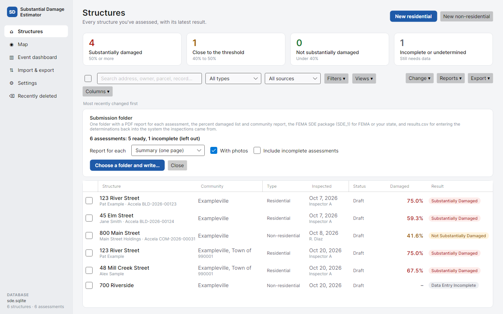

### Other exports
- **Excel**: **Export ▾ > To Excel…** on Structures, or **Import & export > Excel**: every assessment as one row, with
  the same 218 columns as FEMA's *Export to Excel*.
- **Google Earth**: **Import & export > Google Earth map > Save map (.kmz)…**: a pin for each assessment, coloured by
  percent damaged.
- **GIS**: GeoPackage and GeoJSON from the [event dashboard](#the-event-dashboard).

---

## 11. Owner letters
SDE writes a letter to each owner from Word (`.docx`) templates you control. **Review the templates with your
community's counsel before you send any letters**; the starter text is a plain-English starting point, not legal
advice. Every placeholder is listed in [Owner letters](LETTERS.md).

### Set up the templates (once)
1. Open **Settings > Reports & letters** and, under **Owner letters**, click **Create starter templates**. You get three: *Substantial damage
   notice*, *Not substantially damaged notice* and *Substantial improvement determination*.
2. Click **Show folder** and edit them in Word or Pages (save as `.docx`): your letterhead, your ordinance's
   requirements, how to appeal and by when.
3. A placeholder is a field name between guillemets, such as «OwnerName». Type « with ⌥\ and » with ⌥⇧\.

### Write a batch of letters
1. On Structures, check the structures (or filter the list, for example to *Substantially Damaged* and *Final*).
2. Choose **Export ▾ > Owner letters…**.
3. **Choose a template**.
4. Fill in **From**: community, office, office address, phone, email, who signs and their title. These are remembered
   for this database.
5. Click **Choose a folder and write…**. SDE writes a folder named *Letters* with the date and time, holding one
   `.docx` per structure.
6. Print and send them. Then click **Mark as sent…**: the assessments become **Letter sent**, which locks them, and
   the sending is recorded. (For one assessment: **⋯ > Mark letter as sent…** in the editor.)

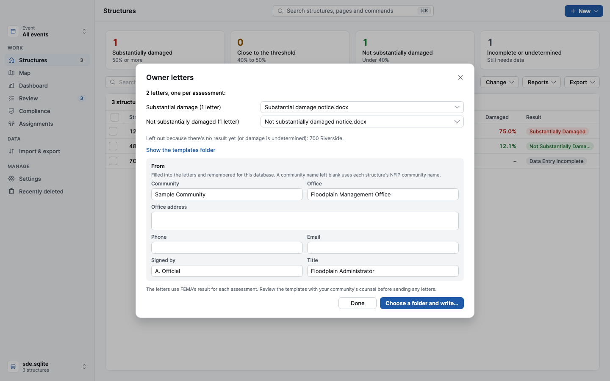

---

## 12. Substantial improvement
Substantial improvement (SI) tracking compares the cost of improvement projects with the structure's market value.
It is a separate finding: it never changes a damage assessment, its percent damaged or FEMA's result.

### Set the rules (once per database)
In **Settings > Reports & letters**, under **Substantial improvement**:
- **Threshold**: percent of market value (the NFIP minimum is 50 percent; your ordinance may be stricter).
- **Look-back period** in years. **0** counts each project on its own.
- Tick **Add earlier projects in the look-back period to the new one** if your ordinance counts improvements
  cumulatively.

### Make a determination
1. Open the structure's assessment and choose **⋯ > Improvements and SI…**.
2. Click **+ New project** and fill in the **Permit number**, **Date (permit or start)**, **Description**, **Cost of
   the improvement** and **Where the cost came from**. Untick **Counts toward substantial improvement** for work that
   doesn't count (say why, for example routine maintenance). Click **Save project**.
3. Check the **Market value of the structure**: the building only, not the land, before the improvement. It starts as
   the building value of the latest damage assessment. Say where it came from.
4. SDE shows the **improvement cost as a percent of market value** and the determination. Add **Notes for the
   determination** and click **Save determination**.
5. **SI determination PDF…** prints it. To tell the owner, use the *Substantial improvement determination* letter
   ([chapter 11](#11-owner-letters)).

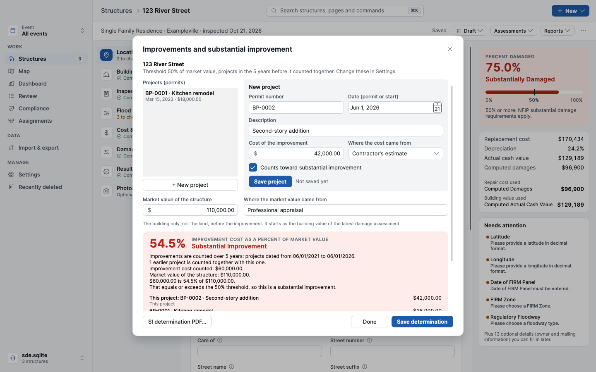

---

## 13. Appeals and contractor bids
When an owner disputes a determination, record the appeal and compare their contractors' bids with the computed
damage.

1. Open the assessment. Set its status to **Appeal** while it is being reconsidered.
2. Choose **⋯ > Appeal…**.
3. Under **The appeal**, fill in the date it was **Received**, the **Basis** (what the owner disputes, and why) and any
   **Notes**. Click **Save appeal**.
4. Under **Contractor bids**, enter each **Contractor**, **Amount** and **Date of the bid**, and click **Add bid**. For
   each bid, SDE shows the percent damaged FEMA's engine gives with that bid as the repair cost (**WITH THIS BID**).
   Nothing changes yet.
5. If you accept a bid, click **Use this bid…** and confirm. The assessment's cost of repairs becomes that contractor's
   estimate and the result is recalculated.
6. Record the **Outcome**, click **Done**, and set the status back to **Final** when the appeal is decided.

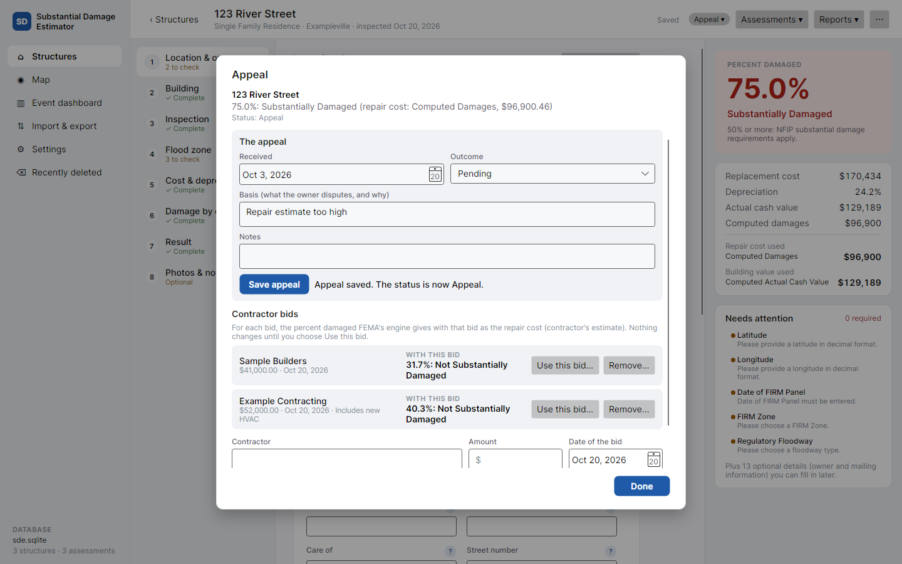

---

## 14. Cumulative damage
Some ordinances count damage from several events together. This is **off** unless you turn it on, and it is a
separate finding: each assessment keeps FEMA's own percent damaged and result, and FEMA's reports and exports don't
change.

1. Open **Settings > Reports & letters** and, under **Cumulative damage**, turn on **Count damage from several events
   together**.
2. Choose the **Method**, the **Look-back period** in years (**0** counts every event on record) and the
   **threshold** your ordinance uses.
3. An assessment's result panel now also shows the cumulative total over the look-back period. Each event is counted
   once, by the date the damage occurred.

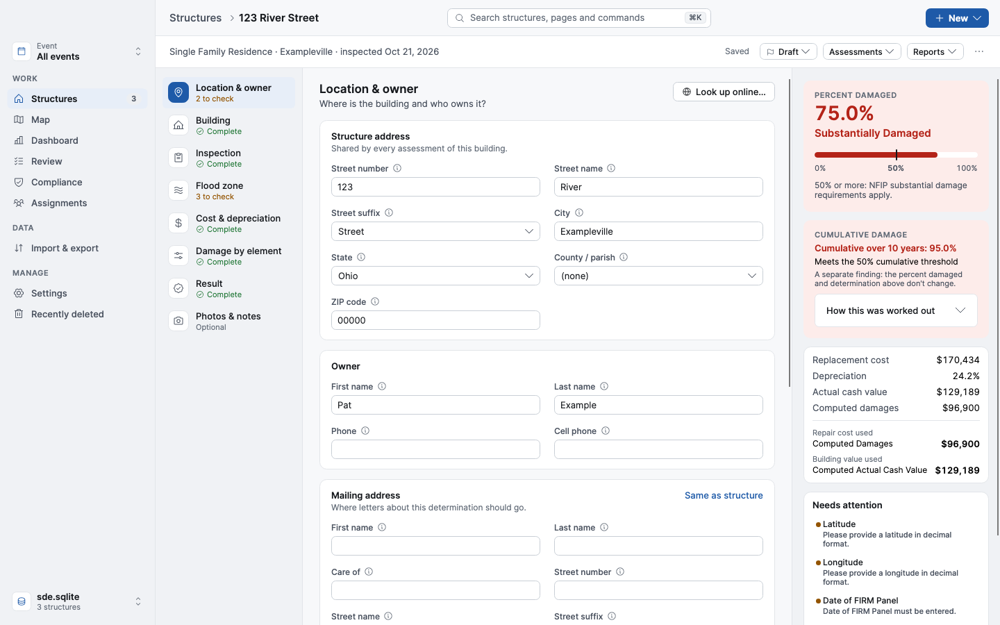

---

## 15. The phone form
Inspectors can look up or add structures, fill in assessments and take photos from a phone's web browser while SDE
runs on a Mac nearby. Nothing is installed on the phone. The full guide, including what it does and doesn't protect
against, is [Phone form](PHONE-FORM.md).

> **Use it only on a network you trust** (your organisation's Wi-Fi, or a hotspot you control). The phone form uses
> plain HTTP, so anyone watching traffic on the same network could read what is sent.

### On the Mac
1. Open **Settings > Phone form** and click **Start phone form**. SDE shows a QR code, an address and a 6-digit PIN.
2. The first time, macOS asks whether SDE may find devices on your local network or accept incoming connections.
   Allow it.

### On each phone
1. Join the **same Wi-Fi network** as the Mac.
2. Scan the QR code with the camera and open the link, or type the address into the browser and enter the PIN.
3. Type your name and tap **Pair**. Your name goes into the history next to each change.
4. Search for a structure or tap **Add a structure**, then fill in the steps. Each field is saved on the Mac when you
   leave it. **Add photo** takes or chooses a photo.

### When you're done
Click **Stop phone form**. It also stops when you quit SDE, and by itself after 12 hours. If a phone is lost, click
**Revoke** next to it.

---

## 16. Backups, moving and sharing

### Automatic backups
SDE backs up the database and its photos into a `Backups` folder next to the database: once on the first opening each
day, and when you quit if anything changed. It keeps the 14 newest. Photos in backups take no extra space.

### Restoring a backup
1. Choose **File > Restore from Backup…** (or **Settings > Backups > Restore from backup…**).
2. Pick the backup by its date and time.
3. SDE backs up the current state first (labelled *before restore*), so a restore can itself be undone, then reopens
   the database.

### Saving a copy
**File > Save a Copy of the Database…** saves a copy wherever you like: before a big import, or to archive the event
when it's over.

### Moving an event to another Mac
1. Quit SDE.
2. Copy the event's folder (the database file, its `attachments` folder and its `Backups` folder) to the other Mac.
3. On the other Mac, choose **File > Open Database…** and pick the database file.

### Working with colleagues
- Give each person their own database, and exchange work with **SDE export folders**
  ([3.2](#32-from-femas-sde-or-another-sde-for-mac) and [chapter 10](#exporting-for-femas-sde-or-your-state)), which
  also work with FEMA's SDE. **Keep mine**, **Replace mine** or **Keep both** decides what happens to structures you
  both have.
- Don't open the same database file from two Macs at once, for example on a shared network drive.
- For inspectors in the field, use the [phone form](#15-the-phone-form).

### Share your setup
**Import & export > Share your setup** gives colleagues your **Saved notes**, **Spreadsheet import mappings** and
**Default values**:

1. Tick what to include and click **Save settings file…**.
2. Your colleague clicks **Import settings file…**. Notes and mappings are added to theirs; default values replace
   theirs after they confirm.

The file is FEMA's user-settings format, so it also works with FEMA's SDE.

**Import profiles** ([3.3](#33-from-a-permit-system-spreadsheet-or-assessor-roll)) are files in
`~/Library/Application Support/SDE/Import Profiles/`, outside any database, so they carry over to the next event. On
the import page, **Show profiles in Finder** lets you send one to a colleague, and **Use a profile someone shared…**
adds one.

---

## 17. Troubleshooting

| Problem | What to do |
|---|---|
| macOS says it can't check SDE, or that it can't be opened | Follow step 6 of [Install](../README.md#step-by-step): System Settings > Privacy & Security > **Open Anyway**. |
| "was created by a newer version of this app" | Someone opened the database in a newer SDE. Update SDE. |
| An `.mdb` import says mdbtools was not found | Your copy of SDE was built without the `.mdb` readers. Use a release build, or run `brew install mdbtools`. |
| I can't change an assessment | It is **Final** or **Letter sent**. Choose another status at the top of the editor; SDE asks for a reason. |
| I can't make an assessment Final | Some damage values are still **Suggested** from a depth table. Accept or change them on the Damage step. |
| An online look-up fails or times out | Check the internet connection and click **Try again**. The Census and FEMA services are sometimes busy, especially right after a disaster. |
| The map has no background | The background needs an internet connection. Structures without coordinates aren't shown at all ([3.5](#35-adding-coordinates)). |
| A phone can't reach the Mac | Check both are on the same Wi-Fi. Guest networks often keep devices apart: use another network or a hotspot. On the Mac, check **System Settings > Privacy & Security > Local Network** allows SDE. |
| I deleted something by mistake | Look in **Recently deleted** (30 days). After that, [restore a backup](#restoring-a-backup). |
| A result differs from FEMA's SDE on Windows | Compare the inputs first (cost data, square footage, depreciation, adjustments, value and repair bases). If they match, please [report it](../README.md#getting-help) with the values, not the owner's details. |
| SDE shows "Something went wrong" | Click **Show details** for the technical message. **Help > Show Log Folder** opens the log files. If you report the problem, read the log first and remove anything personal. |

---

## 18. Keyboard shortcuts
**Help > Keyboard Shortcuts** shows these in the app.

| Shortcut | Action |
|---|---|
| ⌘N | New residential structure |
| ⇧⌘N | New non-residential structure |
| ⌘O | Open a database |
| ⌘S | Save now |
| ⌘I | Import SDE data |
| ⇧⌘I | Import inspections or parcels |
| ⌘E | Export everything to an SDE folder |
| ⌘F | Find (search the list) |
| ⌘Z / ⇧⌘Z | Undo / redo |
| ⌘1 to ⌘9 | The pages in the sidebar, top to bottom |
| ⌘K | Search structures, pages and commands |
| ⌘[ / ⌘] | Previous / next step in the editor |
| 0 to 4 | On a damage slider: 0, 25, 50, 75 or 100 percent |
| Return | Open the selected structure |
| Esc | Close the open panel |
| ⌘M | Minimise the window |
